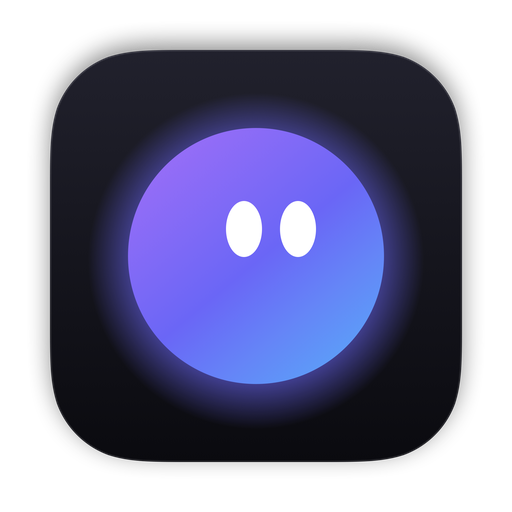
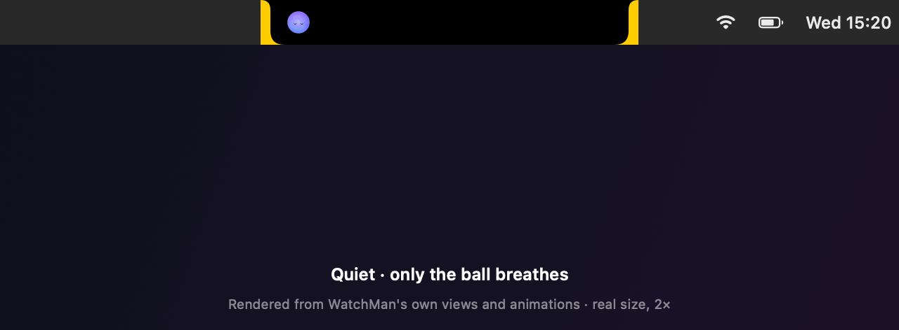
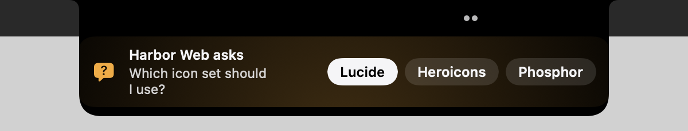
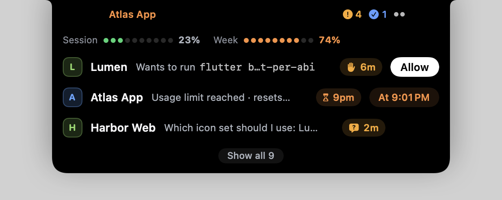
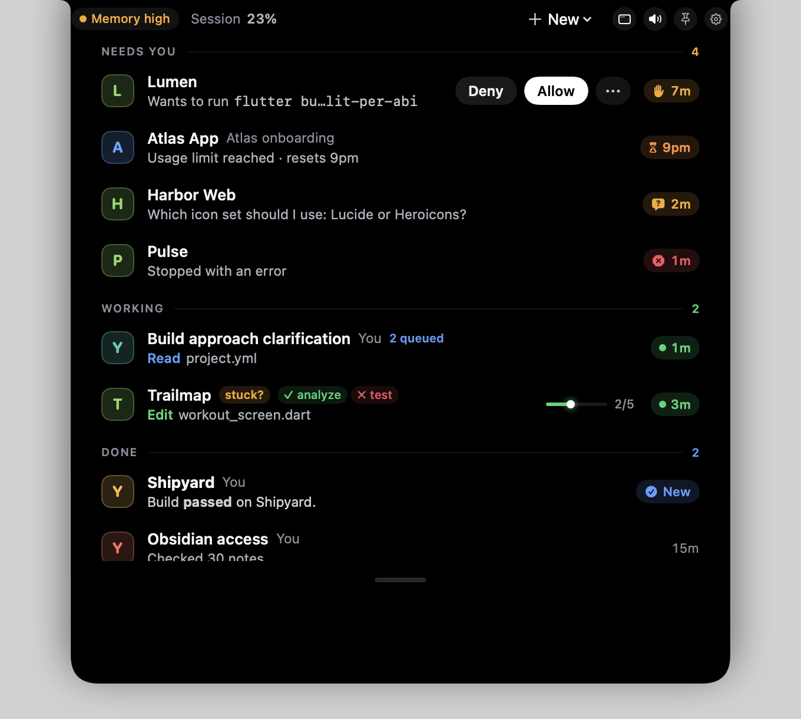
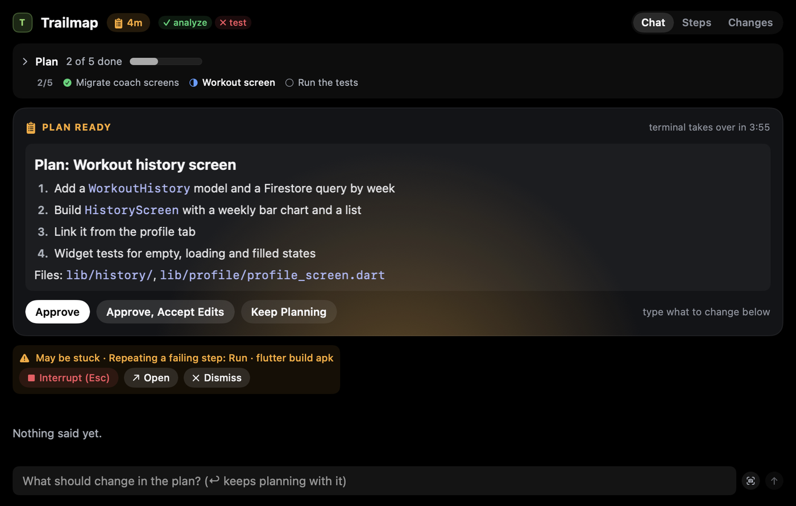
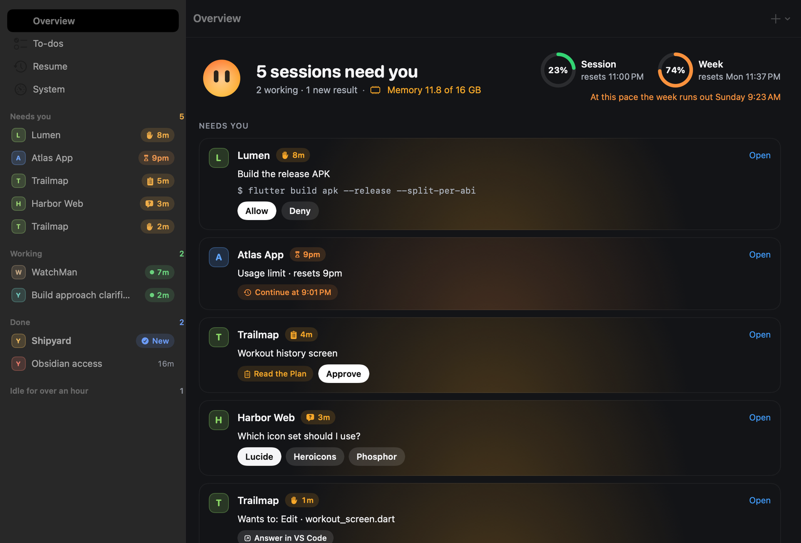
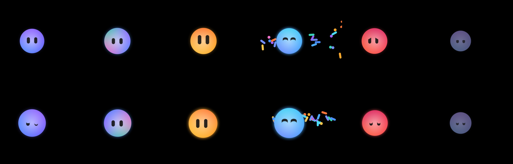
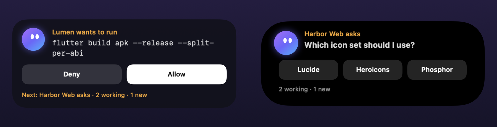
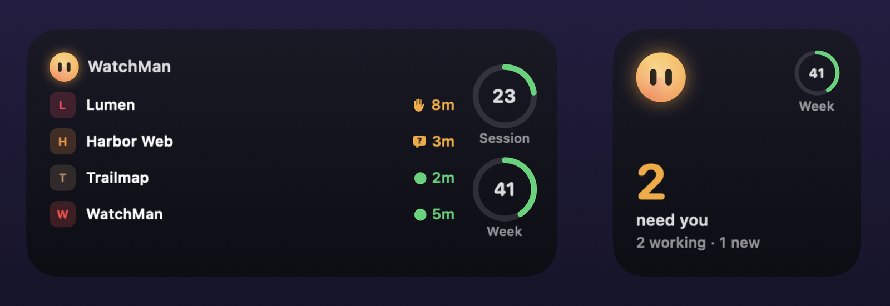

<p align="center">
  
</p>

<h1 align="center">WatchMan</h1>

<p align="center">
  <b>Every Claude Code session on your Mac, living in the notch.</b><br>
  See what each one is doing, answer the ones that need you, and get back to work, without switching windows.
</p>

<p align="center">
  <a href="https://github.com/A7mdMosa/WatchMan/releases/latest"></a>
  
  
  
  <a href="LICENSE"></a>
</p>

<p align="center">
  
</p>

You start three Claude Code sessions, switch to the browser, and twenty minutes later find one has been
waiting on a permission prompt the whole time. **WatchMan fixes that.** A small ball with a face lives beside
your MacBook's notch. It reads along while Claude works, opens its eyes wide when a session needs you, and
throws confetti when one finishes. Click it and every session is there, with the answer one click away.

## What you get

- **Never miss a prompt.** Permission requests, Claude's questions and its plans grow out of the notch with
  their buttons: **Allow** / **Deny**, the question's choices, **Approve** the plan.
- **One look, everything.** Hover for the three sessions that matter most and your plan's usage. Click for
  every session, grouped by what it needs.
- **Answer from where you are.** Reply, queue a message for when Claude finishes, paste a screenshot, or stop
  Claude, right from the notch. **⌥Space** walks you through everything that's waiting.
- **Know your limits.** Session and week usage, with a forecast like "At this pace the week runs out Saturday",
  and sessions that pick up again by themselves when the limit resets.
- **Take it with you.** WatchMan for iPhone shows the same sessions, with a Live Activity, widgets and
  notifications you can answer from the lock screen.
- **Private by design.** No accounts, no servers, no analytics. See [PRIVACY.md](PRIVACY.md).

## A tour

| | |
|---|---|
| <br>**Claude asks, you click.** Questions, permissions and plans arrive under the notch with their answers. | <br>**Hover** for your usage and the three sessions that matter most. |
| <br>**Click** for every session, grouped by what it needs, with Allow and Deny inline. | <br>**A session's page**: the chat as the terminal shows it, Claude's plan in full, Steps and Changes. |



**The window** (with a Dock icon while it's open) puts it all on one screen: a sidebar of every session, an
Overview where every waiting session can be answered in place, your usage with a forecast, projects with
changes not committed or pushed, today's timeline and where the week's tokens went. Every command is in the menu
bar with a shortcut.

### Meet the ball



Calm when all is quiet, swirling while Claude works, amber with wide eyes when something needs you, a happy
squint and confetti when a session finishes, red and worried on an error, and dim and asleep when nothing's
going on. It blinks, glances around, and never steals your focus.

### WatchMan for iPhone





The iPhone app shows every session, its chat, steps and changes, your usage and today's Overview, and answers
prompts: Allow or Deny, a question's choices, Approve or Keep Planning, or a reply with photos. It also starts new
sessions, resumes old chats and changes WatchMan's settings on the Mac.

- **Live Activity and Dynamic Island**: the session that needs you, with its buttons right there.
- **Widgets** on the home screen and lock screen: every session's state and your usage at a glance.
- **Notifications with buttons**: Allow (after Face ID), Deny, or Claude's choices, one thread per session.
- **No server, no pairing**: the Mac and the iPhone talk through your own private iCloud database.

The iPhone app is coming to the App Store. Until then you can build it from source (see below).

## Install

1. **Download** `WatchMan-<version>.zip` from [Releases](https://github.com/A7mdMosa/WatchMan/releases/latest),
   unzip it and drag **WatchMan** to Applications. It's signed with a Developer ID and notarized by Apple, so it
   opens without warnings.
2. **Open WatchMan.** Settings opens on a setup checklist. Click **Install** next to "Connect to Claude Code":
   it adds WatchMan's hook to `~/.claude/settings.json` (after a dated backup, keeping your other hooks).
3. **Allow Automation** when macOS asks, so WatchMan can open a session's tab and type your replies.
   Accessibility is optional: it lets WatchMan use the space left of the notch too.
4. **iPhone** (optional): install WatchMan for iPhone, sign in to the same Apple ID on both, and turn on the link in
   WatchMan's Settings → iPhone.

New sessions show up as you start them; sessions already running appear within a few seconds.

### Requirements

- macOS 15 or later. Made for a MacBook with a notch, and works without one too (on any display).
- [Claude Code](https://claude.com/claude-code).
- Ghostty 1.3+ to open exact tabs and type replies. iTerm2 and Terminal.app are supported too. VS Code sessions are
  shown, but WatchMan can't type into VS Code (it isn't scriptable).
- For the iPhone app: iOS 18 or later, and iCloud on both devices with the same Apple ID.

## Permissions

| Permission | Why | Needed? |
|---|---|---|
| Automation (Ghostty, iTerm2, Terminal) | Open a session's tab, type replies, start sessions | For those actions |
| Accessibility | See where the menus end and where an iPhone Live Activity sits in the menu bar | Optional |
| iCloud | The link to WatchMan for iPhone | Only for the iPhone app |
| Screen Recording | Only if you use the window-screenshot button | Optional |

WatchMan doesn't read your screen, your code or your keystrokes. Its only network traffic is iCloud (for the
iPhone link), a check for a newer version on GitHub at launch, and ntfy if you turn on ntfy alerts.

## More

- **Search every past chat** and resume one in a new tab.
- **Continue automatically** when a usage limit resets.
- **Context fullness** per chat, with `/compact` one click away when it's high.
- **Sounds per moment**, quiet hours and muted projects.
- **Phone alerts without the iPhone app**, with Allow / Deny buttons, through [ntfy](https://ntfy.sh).
- **A daily Dev Log** in your Obsidian vault: what every session did, with links (Settings → Obsidian).
- **A System page** for memory, leftover processes (Gradle daemons, emulators) and token use.

## How it works

1. Claude Code runs `watchman-hook` for each of 12 hook events. The hook adds which terminal and tab the session
   runs in, and forwards the event over a Unix socket in `~/Library/Application Support/WatchMan/`. For a permission
   prompt it waits for your answer. It never blocks Claude Code: if WatchMan isn't running, it exits at once.
2. WatchMan keeps one entry per session and fills in titles, replies, test results and usage from the transcripts
   in `~/.claude/projects/`. It finds sessions that were already running in Claude Code's registry,
   `~/.claude/sessions/`.
3. It controls terminals with AppleScript. Ghostty tabs are matched to sessions by briefly tagging the session's
   tty with a unique working directory.
4. The notch is a transparent panel holding a black island that SwiftUI and Core Animation animate. Outside the
   island, every click passes through. There are no polling timers: WatchMan uses no CPU while nothing happens.
5. The iPhone link writes each session to your private CloudKit database (chats in encrypted fields), and iCloud's
   silent pushes wake the other side.

## Files WatchMan touches

- `~/.claude/settings.json`: its hook entries, only when you install or remove them, and your status line command,
  wrapped so WatchMan gets your plan's usage (it still prints exactly what it did). A dated backup comes first, every
  time.
- `~/Library/Application Support/WatchMan/`: the hook, the socket, and the last two days of session events.
- Your Obsidian vault, only if you turn on the Dev Log: one note a day in the folder you choose.
- Its own preferences (`com.moussa.WatchMan`).

## Uninstall

1. WatchMan Settings → Claude Code → Hooks → **Remove**, and **Stop Showing Plan Usage** to put your status line
   back. (Or: `python3 scripts/install-hooks.py --hook ~/Library/Application\ Support/WatchMan/watchman-hook --remove`
   and `--statusline off`.)
2. Quit WatchMan and delete `/Applications/WatchMan.app` and `~/Library/Application Support/WatchMan`.

## Build from source

```sh
brew install xcodegen
git clone https://github.com/A7mdMosa/WatchMan.git && cd WatchMan
xcodegen
scripts/install.sh   # builds a Release copy, signs it, installs it in /Applications
```

To build with your own Apple developer team, set `DEVELOPMENT_TEAM` and `bundleIdPrefix` in `project.yml`, and
use your own iCloud container in `Config/*.entitlements` for the iPhone link. Run signing scripts outside any
command sandbox, since they need the keychain.

- `scripts/install.sh`: build, sign and install locally.
- `scripts/release.sh`: archive, sign with Developer ID, notarize through Xcode and zip a release
  (`--publish` creates the GitHub release).
- `xcodebuild -project WatchMan.xcodeproj -scheme WatchMan -configuration Debug -derivedDataPath build.noindex test`:
  the unit tests.

### Layout

- `Sources/Core`: pure logic with unit tests: hook events, session rules, transcripts, usage, the iPhone link's
  records.
- `Sources/Hook`: the hook relay.
- `Sources/App`: the Mac app (socket server, session store, terminals, notch, menu bar, window, settings).
- `Sources/Phone`, `Sources/PhoneShared`, `Sources/PhoneWidgets`, `Sources/PhoneAlerts`: the iPhone app, its widgets
  and Live Activity, and its notification extensions.
- `Sources/Snapshots`: renders every screen with sample data to PNGs and GIFs (this README's images come from it).

## Credits

The hook relay design and the notch panel setup were inspired by [Coucou](https://github.com/louis-cfm/coucou) by
Louis Raillé (MIT). See [NOTICE.md](NOTICE.md). WatchMan uses none of Coucou's name, character, icon or sounds.

Claude and Claude Code are trademarks of Anthropic. WatchMan is an independent project and isn't affiliated with
Anthropic.

## License

[MIT](LICENSE) © 2026 Ahmed Moussa
